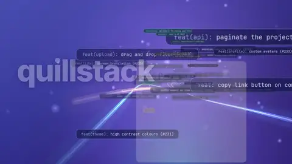

<h1 align="center"><code>/video</code></h1>

<p align="center"><b>Launch videos and product videos for your app, made in Claude Code.</b><br>
Advanced motion design and 3D, with sound, checked frame by frame. 9:16 for Reels, Shorts and TikTok, 16:9 for your
site and X.<br>Free and open source (MIT). Runs on your computer. Needs Claude Code.</p>

Every film below was made by this skill from **one prompt** in a clean folder, with no editing by hand (a film that
also got a round of notes says so). Click one to watch it with sound and see its prompt, its plan and its gate numbers.

<table>
<tr>
<td width="50%" valign="top"><a href="https://munvard.github.io/video-skill/films/mossbook.html"></a><br><b>Mossbook</b>: a mobile app (invented)<br><sub>One prompt, 31 min,Opus 5.5. 9:16 and 16:9.</sub></td>
<td width="50%" valign="top"><a href="https://munvard.github.io/video-skill/films/quillstack.html"></a><br><b>quillstack</b>: a developer tool (invented)<br><sub>One prompt, 32 min,Opus 5.5. 9:16 and 16:9.</sub></td>
</tr>
</table>

## With and without the skill

The same 15 second brief (five lines of copy, 1920x1080, no voice), given to Claude Code twice in a clean folder:
once with nothing installed, once with `/video`. Same model, one prompt each, no help.
This brief was also used while the skill was built (two of its rules came from an earlier run of it), so read it
as a fair test of the result, not a blind one.

<a href="https://munvard.github.io/video-skill/films/tidepool.html"></a>

| | Without | With `/video` |
|---|---|---|
| Minutes, prompt to file | 3.3 | 6.4 |
| Turns | 20 | 26 |
| Gates failed (check.py) | 4 of 8: frame 0, dead, end hold, slab | 0 of 8 |
| Loudness | -14.5 LUFS | -13.8 LUFS |

## Install

Inside Claude Code:

```text
/plugin marketplace add munvard/video-skill
/plugin install video@video-skill
```

> **You need**
> - Claude Code, with a Claude plan (Pro, Max, Team or Enterprise) or an API account
> - ffmpeg and Python 3 with numpy
> - Optional: Node 22 and Chrome for motion design, Blender for 3D
>
> The first run checks your tools and tells you what is missing. Everything else is free and runs on your computer:
> no API keys, no paid services.

## Use

```text
/video
/video a 20 second launch post for our search, 9:16
/video a 16:9 hero film for the site, make it 3D
/video learn the style of reference.mp4
```

With no text, in a project folder, it reads the README, the site and the screenshots, and makes that product's launch
film.

## How it works

- **QUICK or STUDIO.** QUICK is one concept and a render in minutes. STUDIO writes four very different concepts, shows
  you stills before it builds (the look gate), and judges the result for beauty before it checks the numbers.
- **Motion design in code.** Film pages in HTML and canvas with measured easing curves, rendered frame by frame in
  headless Chrome, in parallel.
- **Real 3D.** Blender with free CC0 materials, models and light from Poly Haven and ambientCG: EEVEE for most shots,
  Cycles for the hero shots.
- **Sound made in code.** Music on a beat grid, a sound for every event on screen, an optional local voice checked
  word by word, and a master to -14 LUFS.
- **Checked like a viewer on a phone.** `check.py` prints PASS or FAIL with numbers: frame 0 not empty, no dead or
  frozen stretches, the end hold, reading time for every line, text height at 360 px wide, the 9:16 safe area,
  loudness and true peak, the loop seam.
- **It learns your taste.** Your reactions go to `.video/taste.md` in your project and win over its defaults.

## What is inside

| Part | What it does |
|---|---|
| [`SKILL.md`](plugins/video/skills/video/SKILL.md) | the director: understand, choose, plan, look gate, build, check, deliver, learn |
| [`kit/`](plugins/video/skills/video/kit/README.md) | the render engine: a parallel headless Chrome renderer, a 2D canvas kit, a ray tracer |
| [`scripts/`](plugins/video/skills/video/scripts) | `check.py` gates, `sound.py`, `voice.py`, `finish.py`, `assets.py`, `doctor.py`, `study.py`, the Blender kit |
| [`styles/`](gallery/README.md) | 46 style cards, 12 at full depth, with a preview each |
| [`reference/`](plugins/video/skills/video/reference) | craft rules, sound, Blender, engines, the checklist |

## Honest status

- The films above are the proof. Each page shows the exact prompt, the minutes, the model and the plan used.
- Styles: 0 proven, 0 studied, 46 drafts. See the [style library](gallery/README.md).
- Tested on Windows 11 with an AMD GPU. Mac and Linux paths are written but less tested.
- A STUDIO film is a long, heavy run that uses a lot of your Claude plan. QUICK is the cheap path.
- Live-action styles need your own footage. No skill can promise views, and this one will not pretend to.

MIT licence. Borrowed code and its licences: [`NOTICE.md`](plugins/video/skills/video/NOTICE.md). Fonts and gallery
files: [`gallery/LICENSES.md`](gallery/LICENSES.md). Release notes: [`RELEASE_NOTES.md`](RELEASE_NOTES.md).
