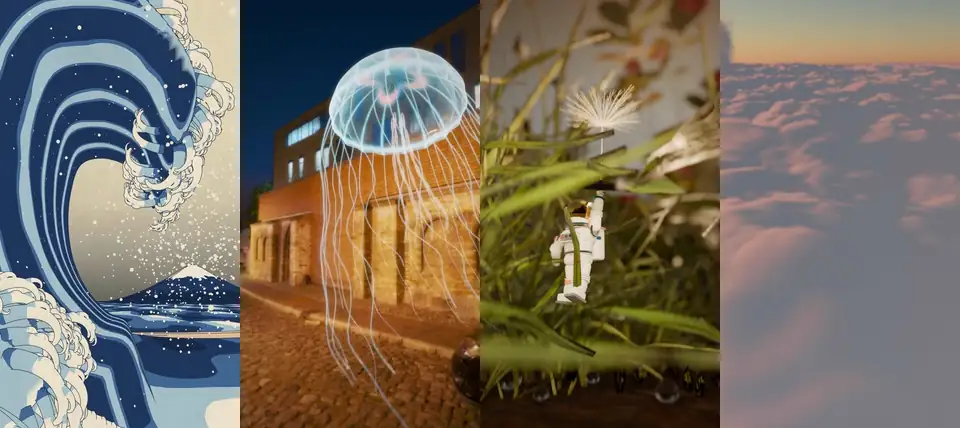
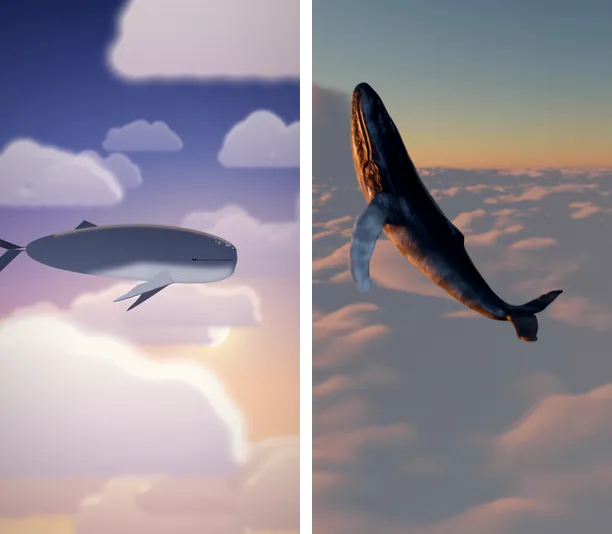
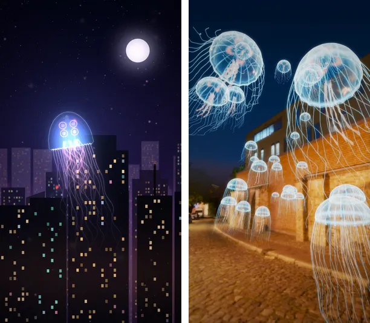
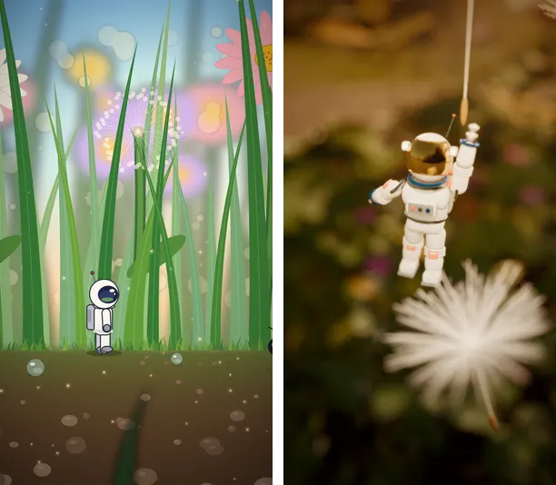
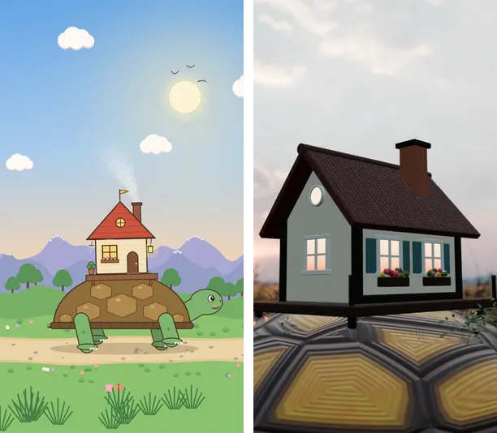
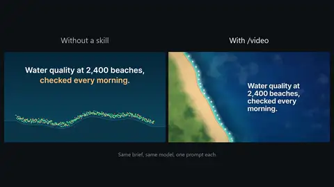
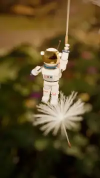
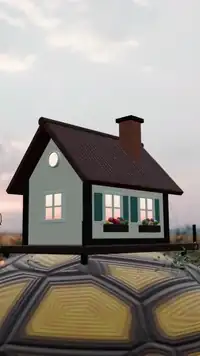
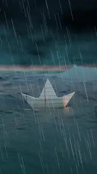
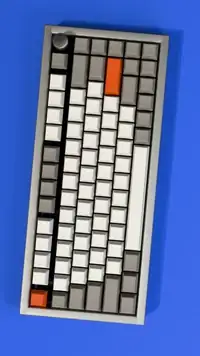

<div align="center">

<a href="#films-it-made"></a>

# /video

### Type `/video` in Claude Code. Get a finished film: 3D, motion design and sound, with every frame checked.

```text
/plugin marketplace add munvard/video-skill
/plugin install video@video-skill
```

<a href="LICENSE"></a> <a href="#install"></a>

</div>

## Same prompt, with and without

Each pair is the same prompt typed into Claude Code twice in a clean folder: left without any skill, right with
`/video`. Same model, no human notes during the runs. Click a pair for the run summaries (time, turns, cost, the
session's own last message).

<table>
<tr>
<td width="50%" valign="top"><a href="docs/unslop/3"></a><br><sub><b>a whale swimming through the clouds</b><br>Without: 5.4 min, $0.87. With /video: 107.5 min, $8.05.</sub></td>
<td width="50%" valign="top"><a href="docs/unslop/7"></a><br><sub><b>a jellyfish drifting through a city at night</b><br>Without: 7.2 min, $0.78. With /video: 44.4 min, $3.63.</sub></td>
</tr>
<tr>
<td width="50%" valign="top"><a href="docs/unslop/2"></a><br><sub><b>a tiny astronaut lost in a garden</b><br>Without: 7.7 min, $1.40. With /video: 144.0 min, $7.51.</sub></td>
<td width="50%" valign="top"><a href="docs/unslop/9"></a><br><sub><b>a tiny house on the back of a walking turtle</b><br>Without: 5.7 min, $1.05. With /video: 149.4 min, $6.23.</sub></td>
</tr>
</table>

Costs are at API list price, from each session's own log. `/video` takes longer and costs more: it plans, tests a
look, builds in Blender and checks the result before it delivers. All ten pairs, including a failed run, are in
[docs/unslop](docs/unslop).

<details><summary>A motion design test with a fixed checklist</summary>

<a href="https://munvard.github.io/video-skill/films/tidepool.html"></a>

The same 15 second brief for a beach app, the same model. Without a skill: 3.3 minutes and 4 of 8 checks failed
(frame 0, dead, end hold, slab). With `/video`: 6.4 minutes and 0 of 8 failed. This brief was also used while the skill
was built (two of its rules came from an earlier run), so it shows the result fairly but it is not a blind test. The
[film page](https://munvard.github.io/video-skill/films/tidepool.html) has both prompts, both films and every number.

</details>

## Films it made

Every film below came out of a `/video` run with no editing by hand. The line under each one is its prompt (the
reel format part is cut short). Click a film for its run.

<table>
<tr>
<td width="33%" valign="top"><a href="docs/unslop/10"></a><br><sub><code>Hokusai's The Great Wave off Kanagawa rebuilt as a 3D scene, ... then the camera flies into the wave</code></sub></td>
<td width="33%" valign="top"><a href="docs/unslop/7"></a><br><sub><code>a jellyfish drifting through a city at night</code></sub></td>
<td width="33%" valign="top"><a href="docs/unslop/2"></a><br><sub><code>a tiny astronaut lost in a garden</code></sub></td>
</tr>
<tr>
<td valign="top"><a href="docs/unslop/3"></a><br><sub><code>a whale swimming through the clouds</code></sub></td>
<td valign="top"><a href="docs/unslop/9"></a><br><sub><code>a tiny house on the back of a walking turtle</code></sub></td>
<td valign="top"><a href="docs/unslop/1"></a><br><sub><code>a paper boat in a storm</code></sub></td>
</tr>
<tr>
<td valign="top"><a href="docs/unslop/4"></a><br><sub><code>Make the launch film for this project</code> (an invented desk light that works as a focus timer)</sub></td>
<td valign="top"><a href="docs/unslop/5"></a><br><sub><code>a rubber duck on a desk helping debug code</code></sub></td>
<td valign="top"><a href="docs/unslop/6"></a><br><sub><code>a product shot of a mechanical keyboard</code></sub></td>
</tr>
</table>

Motion design too: [Mossbook](https://munvard.github.io/video-skill/films/mossbook.html), the launch film for an
invented plant app, made from its README and two source files in 31 minutes, in a 9:16 and a 16:9 cut. More in the
[gallery](https://munvard.github.io/video-skill).

## How it works

| 1. Understand | 2. Pitch | 3. Look test | 4. Build | 5. Check every frame | 6. Deliver |
|---|---|---|---|---|---|
| Reads your prompt, or your README, site and screenshots | Four very different ideas, then picks one | Stills and a moving test before the long render | Motion design in HTML and canvas, 3D in Blender, music and sound in code | PASS or FAIL with numbers, and every FAIL gets fixed | The film, its cuts, and what was checked |

What the checks catch, the way a phone viewer would see it:

- a weak or dark first frame, and a slow first 3 seconds of a reel
- text that is too small at phone size, on screen too short to read, or low in contrast
- text outside the 9:16 safe area, where the app's buttons cover it
- frozen stretches, big flat empty areas, and a loop that jumps
- sound that is too loud, too quiet or clipped

```text
/video a 20 second launch post for our search, 9:16
/video a 16:9 hero film for the site, make it 3D
/video learn the style of reference.mp4
```

## Install

Inside Claude Code:

```text
/plugin marketplace add munvard/video-skill
/plugin install video@video-skill
```

Then open your project and type `/video`. With no other words, it reads your README, site and screenshots and makes
that product's launch film. Your reactions go to `.video/taste.md` in your project and win over its defaults next time.

<details><summary><b>What you need</b></summary>

- Claude Code, with a Claude plan (Pro, Max, Team or Enterprise) or an API account
- ffmpeg and Python 3 with numpy
- Optional: Node 22 and Chrome for motion design, Blender for 3D

The first run checks your tools and tells you what is missing. No API keys and no paid services: 3D materials, models
and light come from Poly Haven and ambientCG (CC0), and the music and sound are made in code on your computer.

</details>

<details><summary><b>What is inside</b></summary>

| Part | What it does |
|---|---|
| [`SKILL.md`](plugins/video/skills/video/SKILL.md) | the director: understand, choose, plan, look gate, build, check, deliver, learn |
| [`kit/`](plugins/video/skills/video/kit/README.md) | the render engine: a parallel headless Chrome renderer, a 2D canvas kit, a ray tracer |
| [`scripts/`](plugins/video/skills/video/scripts) | `check.py` gates, `sound.py`, `voice.py`, `finish.py`, `assets.py`, `doctor.py`, `study.py`, the Blender kit |
| [`styles/`](gallery/README.md) | 46 style cards, 12 at full depth, with a preview each |
| [`reference/`](plugins/video/skills/video/reference) | craft rules, sound, Blender, engines, the checklist |

</details>

## Questions and limits

- **How long does a film take?** In the runs in [docs/unslop](docs/unslop), the `/video` 3D runs took 42 to 165 minutes;
  the two that shared the computer with other renders took 379 and 430 minutes, including pauses. The motion design
  films above took 6.4 and 31 minutes.
- **Does it use a lot of my plan?** Yes, a 3D film is a long run and uses a fair part of a Claude plan's limits. At API
  list price the `/video` runs above cost $3.63 to $11.08. QUICK mode is one idea and a short render.
- **Does it always work?** No. One of the eleven `/video` runs there failed: the [fox](docs/unslop/8) spent its time on motion tests for the
  running fox and was stopped at 150 minutes with no film. In [The Great Wave](docs/unslop/10) pair the plain run looks closer to the
  print, because it used the print's own pixels. Both are published with the rest.
- **Which computers?** Tested on Windows 11 and macOS on Apple silicon. Linux paths are written but less tested.
- **Styles:** 0 proven by a film, 0 measured from real work, 46 drafts. See the [style library](gallery/README.md).
- Live-action styles need your own footage. No skill can promise views.

MIT licence. Borrowed code and its licences: [`NOTICE.md`](plugins/video/skills/video/NOTICE.md). Fonts and gallery
files: [`gallery/LICENSES.md`](gallery/LICENSES.md). Release notes: [`RELEASE_NOTES.md`](RELEASE_NOTES.md).
