<p align="center"></p>

<h3 align="center">Type <code>/video</code>. Get a finished video.</h3>

<p align="center">
A director for Claude Code. It finds the idea, picks or invents the style, builds every frame in code and 3D,<br>
makes the sound, checks its own work, and learns your taste.
</p>

<p align="center">
<a href="#install">Install</a> &nbsp;·&nbsp; <a href="#one-ball-46-styles">46 styles</a> &nbsp;·&nbsp; <a href="#made-to-travel">Made to travel</a> &nbsp;·&nbsp; <a href="#honest-status">Honest status</a> &nbsp;·&nbsp; <a href="#add-a-style">Add a style</a>
</p>

```text
/video
/video a 20 second post about our search
/video something that could go viral for my bakery
/video a love letter to my city, no product
/video learn the style of reference.mp4
```

You never choose from a menu. With no words at all, it looks at your project and starts.

## How it thinks

<p align="center">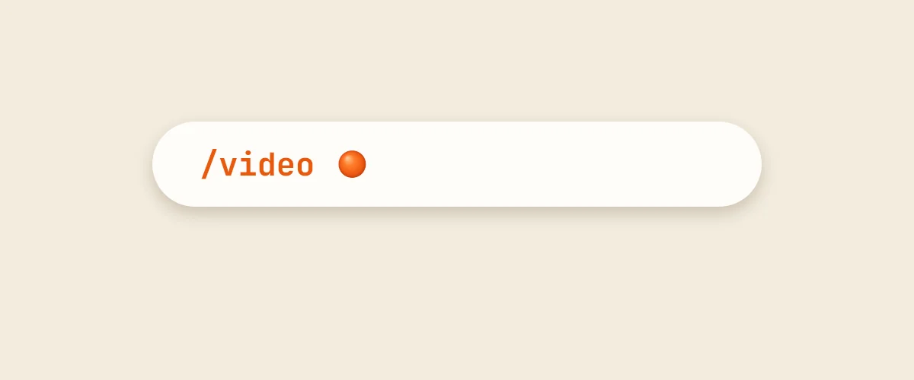</p>

- **It looks for an idea before a look.** Four very different concepts, and it throws away every one that would work for any other product.
- **It plans by frame.** What moves, why, how it becomes the next shot, and which sound lands on it.
- **It builds the hardest seconds first**, at final quality, and changes the method if they are not good.
- **It checks like a stranger on a phone.** Frame 0, sound off, every join, every word at 360 px wide, loudness, the loop.
- **It remembers what you said.** Your reactions live in your own project and win over everything here.

## One ball, 46 styles

The same small story, made 46 ways. `/video` can use one, give several of them jobs in one film, invent its own, or ignore the library. Only the cards it needs are loaded, so the library costs your chat almost nothing.

### Cinematic 3D

<table>
<tr>
<td width="25%" valign="top"><a href="plugins/video/skills/video/styles/one-take-thread.md">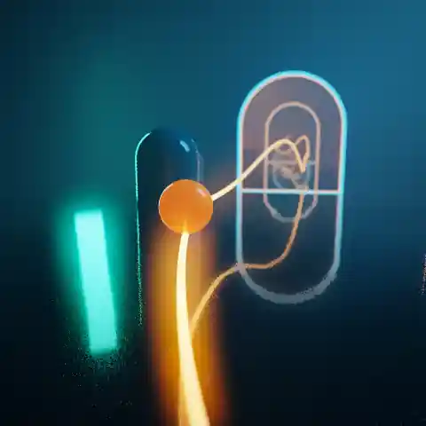</a><br><b>One take with a thread</b> <sup>proven</sup><br><sub>A single camera move through several worlds, led by one glowing object.</sub></td>
<td width="25%" valign="top"><a href="plugins/video/skills/video/styles/toy-diorama.md">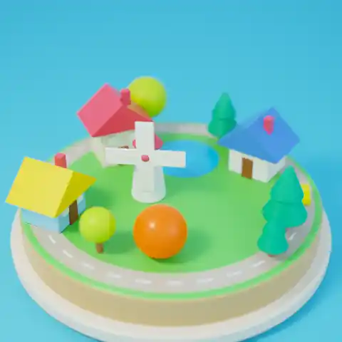</a><br><b>Toy diorama</b> <sup>studied</sup><br><sub>A tiny bright world you want to touch.</sub></td>
<td width="25%" valign="top"><a href="plugins/video/skills/video/styles/clay-stop-motion.md">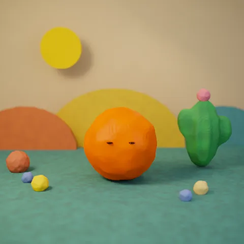</a><br><b>Clay stop motion</b><br><sub>Warm, handmade and a bit imperfect.</sub></td>
<td width="25%" valign="top"><a href="plugins/video/skills/video/styles/macro-material.md">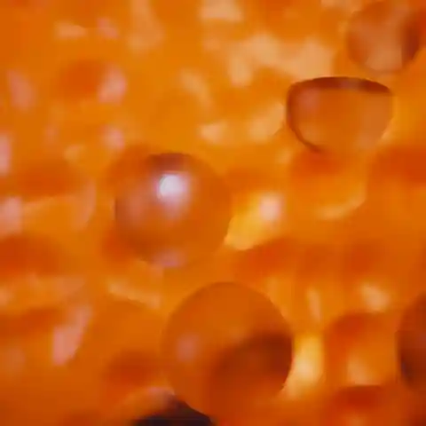</a><br><b>Macro material</b><br><sub>So close you can almost feel it.</sub></td>
</tr>
<tr>
<td width="25%" valign="top"><a href="plugins/video/skills/video/styles/isometric-city.md"></a><br><b>Isometric city</b><br><sub>A living map from above.</sub></td>
<td width="25%" valign="top"><a href="plugins/video/skills/video/styles/glass-light.md"></a><br><b>Glass and light</b><br><sub>Calm, expensive and abstract.</sub></td>
<td width="25%" valign="top"><a href="plugins/video/skills/video/styles/infinite-zoom.md"></a><br><b>Infinite zoom</b><br><sub>You keep falling into the next picture.</sub></td>
<td width="25%" valign="top"><a href="plugins/video/skills/video/styles/exploded-view.md"></a><br><b>Exploded view</b><br><sub>The object opens and explains itself.</sub></td>
</tr>
</table>

### Minimal motion

<table>
<tr>
<td width="25%" valign="top"><a href="plugins/video/skills/video/styles/shape-morph.md"></a><br><b>Shape morph</b> <sup>studied</sup><br><sub>Quiet, exact, and every object turns into the next.</sub></td>
<td width="25%" valign="top"><a href="plugins/video/skills/video/styles/kinetic-type.md"></a><br><b>Kinetic type</b><br><sub>Only words, and they act.</sub></td>
<td width="25%" valign="top"><a href="plugins/video/skills/video/styles/swiss-grid.md">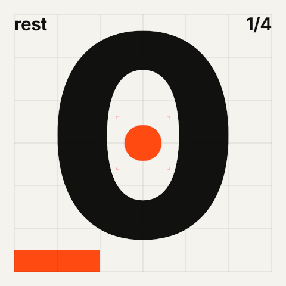</a><br><b>Swiss grid</b><br><sub>A poster that moves.</sub></td>
<td width="25%" valign="top"><a href="plugins/video/skills/video/styles/one-line.md">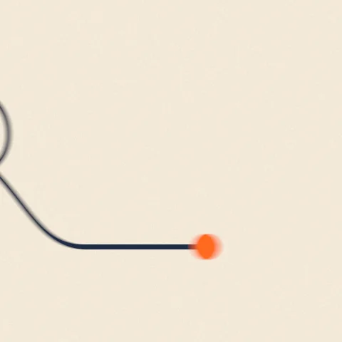</a><br><b>One continuous line</b><br><sub>A single pen never leaves the page.</sub></td>
</tr>
<tr>
<td width="25%" valign="top"><a href="plugins/video/skills/video/styles/soft-gradient.md"></a><br><b>Soft gradient</b><br><sub>Breathing color and one sentence.</sub></td>
<td width="25%" valign="top"><a href="plugins/video/skills/video/styles/blueprint.md">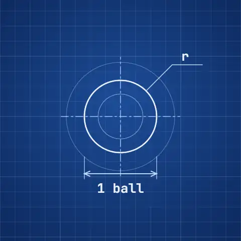</a><br><b>Blueprint</b><br><sub>The drawing becomes the real thing.</sub></td>
</tr>
</table>

### Screen and UI

<table>
<tr>
<td width="25%" valign="top"><a href="plugins/video/skills/video/styles/screen-cinema.md">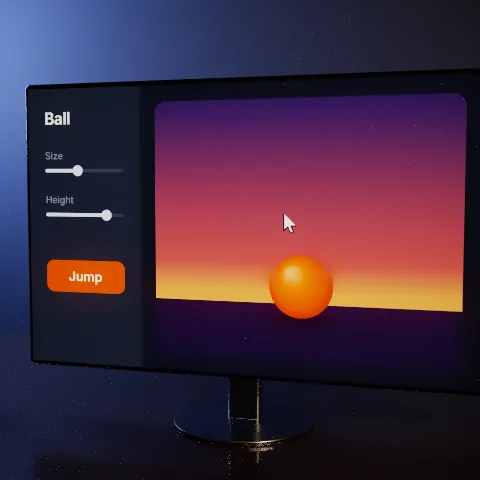</a><br><b>Screen cinema</b><br><sub>A real take filmed like a movie.</sub></td>
<td width="25%" valign="top"><a href="plugins/video/skills/video/styles/cursor-hero.md"></a><br><b>The cursor is the hero</b><br><sub>A tiny character with a job.</sub></td>
<td width="25%" valign="top"><a href="plugins/video/skills/video/styles/floating-layers.md"></a><br><b>Floating layers</b><br><sub>The interface opens in space.</sub></td>
<td width="25%" valign="top"><a href="plugins/video/skills/video/styles/before-after.md">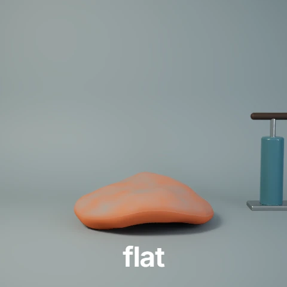</a><br><b>Before and after</b><br><sub>One problem, two worlds.</sub></td>
</tr>
<tr>
<td width="25%" valign="top"><a href="plugins/video/skills/video/styles/terminal-poem.md"></a><br><b>Terminal poem</b><br><sub>Only text, and something huge happens.</sub></td>
<td width="25%" valign="top"><a href="plugins/video/skills/video/styles/honest-race.md"></a><br><b>Honest race</b><br><sub>Two ways, one clock.</sub></td>
</tr>
</table>

### Handmade and graphic

<table>
<tr>
<td width="25%" valign="top"><a href="plugins/video/skills/video/styles/paper-collage.md">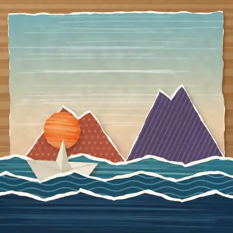</a><br><b>Paper collage</b><br><sub>Cut paper and photos on a table.</sub></td>
<td width="25%" valign="top"><a href="plugins/video/skills/video/styles/scrapbook.md"></a><br><b>Scrapbook</b><br><sub>A private book being filled.</sub></td>
<td width="25%" valign="top"><a href="plugins/video/skills/video/styles/riso-print.md">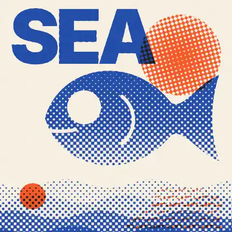</a><br><b>Riso print</b><br><sub>Two inks slightly out of line.</sub></td>
<td width="25%" valign="top"><a href="plugins/video/skills/video/styles/whiteboard-lesson.md">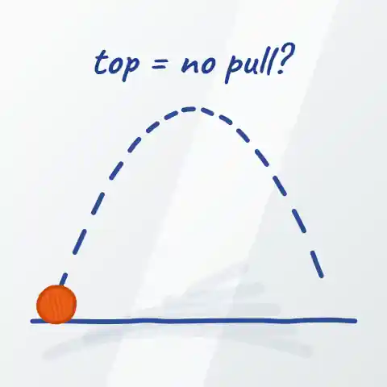</a><br><b>Whiteboard lesson</b><br><sub>A good teacher draws it for you.</sub></td>
</tr>
<tr>
<td width="25%" valign="top"><a href="plugins/video/skills/video/styles/pixel-art.md">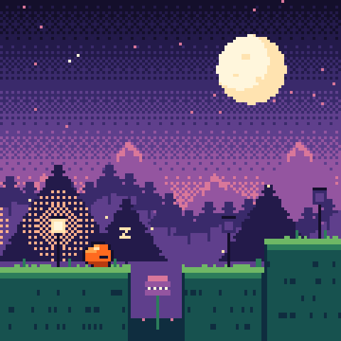</a><br><b>Pixel art</b><br><sub>A small original world in pixels.</sub></td>
<td width="25%" valign="top"><a href="plugins/video/skills/video/styles/comic-panels.md"></a><br><b>Comic panels</b><br><sub>A page that comes alive.</sub></td>
<td width="25%" valign="top"><a href="plugins/video/skills/video/styles/retro-computer.md">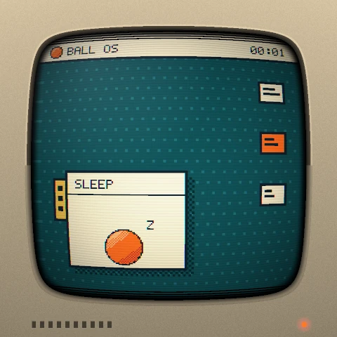</a><br><b>Retro computer</b><br><sub>An invented old computer runs your idea.</sub></td>
<td width="25%" valign="top"><a href="plugins/video/skills/video/styles/analog-tape.md">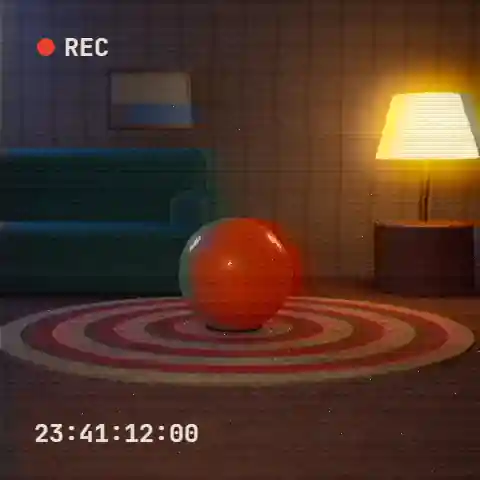</a><br><b>Analog tape</b><br><sub>A found recording.</sub></td>
</tr>
</table>

### Live footage

<table>
<tr>
<td width="25%" valign="top"><a href="plugins/video/skills/video/styles/pov-moment.md"></a><br><b>POV moment</b><br><sub>You are the person it happens to.</sub></td>
<td width="25%" valign="top"><a href="plugins/video/skills/video/styles/face-to-camera.md"></a><br><b>Face to camera</b><br><sub>One person says one true thing.</sub></td>
<td width="25%" valign="top"><a href="plugins/video/skills/video/styles/desk-hands.md">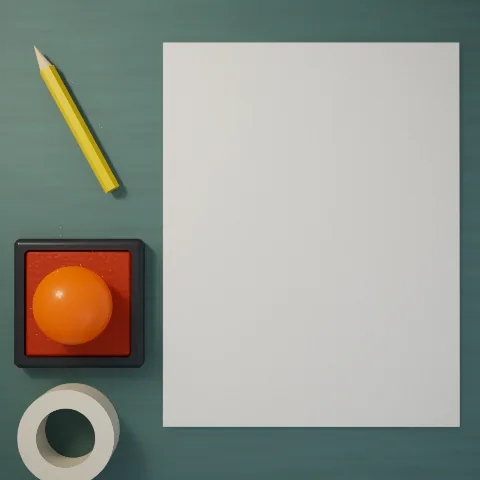</a><br><b>Hands on a desk</b><br><sub>A quiet making process from above.</sub></td>
<td width="25%" valign="top"><a href="plugins/video/skills/video/styles/sound-first.md"></a><br><b>Sound first</b><br><sub>You hear it before you understand it.</sub></td>
</tr>
<tr>
<td width="25%" valign="top"><a href="plugins/video/skills/video/styles/mini-documentary.md"></a><br><b>Mini documentary</b><br><sub>A real person and what changed.</sub></td>
</tr>
</table>

### Story and comedy

<table>
<tr>
<td width="25%" valign="top"><a href="plugins/video/skills/video/styles/mascot-short.md">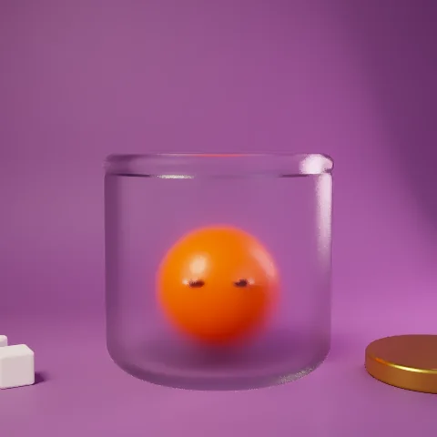</a><br><b>Mascot short</b><br><sub>A character wants something.</sub></td>
<td width="25%" valign="top"><a href="plugins/video/skills/video/styles/one-joke.md">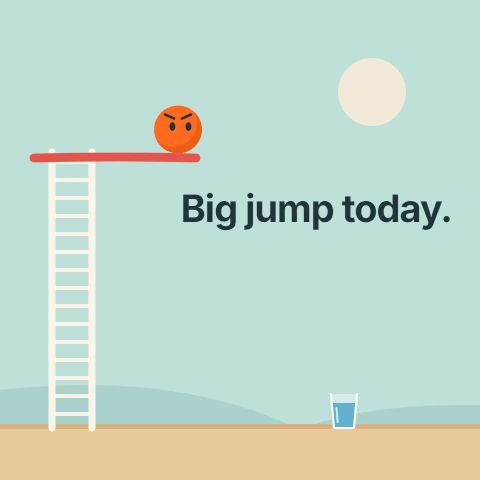</a><br><b>One joke</b><br><sub>A setup, a turn, and it ends.</sub></td>
<td width="25%" valign="top"><a href="plugins/video/skills/video/styles/movie-trailer.md"></a><br><b>Movie trailer</b><br><sub>A tiny problem treated as an epic.</sub></td>
<td width="25%" valign="top"><a href="plugins/video/skills/video/styles/myth-turn.md">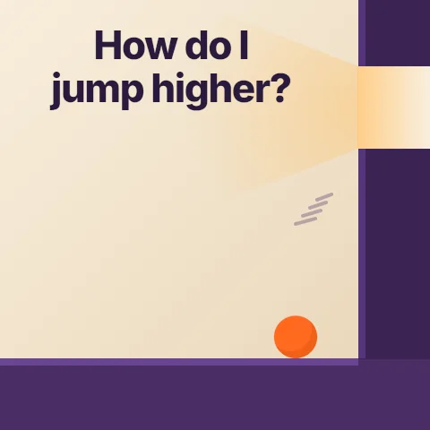</a><br><b>Myth and turn</b> <sup>studied</sup><br><sub>An argument with a turn in the middle.</sub></td>
</tr>
<tr>
<td width="25%" valign="top"><a href="plugins/video/skills/video/styles/native-lofi.md"></a><br><b>Native low-fi</b><br><sub>A friend made it on a phone.</sub></td>
</tr>
</table>

### Data and explanation

<table>
<tr>
<td width="25%" valign="top"><a href="plugins/video/skills/video/styles/data-motion.md"></a><br><b>Data in motion</b><br><sub>One number becomes something you can see.</sub></td>
<td width="25%" valign="top"><a href="plugins/video/skills/video/styles/cutaway.md"></a><br><b>Cutaway</b><br><sub>The wall opens and you see how it works.</sub></td>
<td width="25%" valign="top"><a href="plugins/video/skills/video/styles/map-journey.md">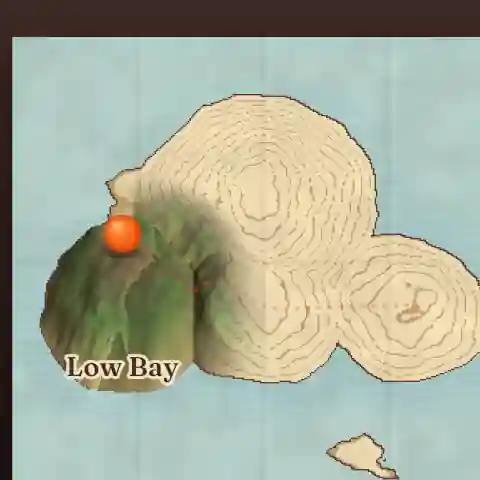</a><br><b>Map journey</b><br><sub>One dot crosses the world.</sub></td>
<td width="25%" valign="top"><a href="plugins/video/skills/video/styles/time-machine.md">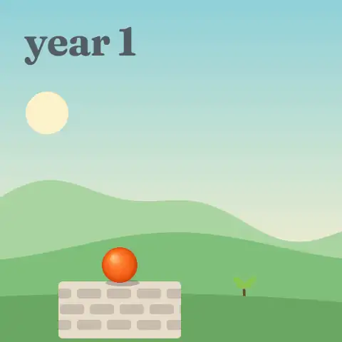</a><br><b>Time machine</b><br><sub>One object through many years.</sub></td>
</tr>
</table>

### Social speed

<table>
<tr>
<td width="25%" valign="top"><a href="plugins/video/skills/video/styles/beat-cut.md"></a><br><b>Beat cut</b> <sup>proven</sup><br><sub>Loud, fast, in rhythm.</sub></td>
<td width="25%" valign="top"><a href="plugins/video/skills/video/styles/perfect-loop.md">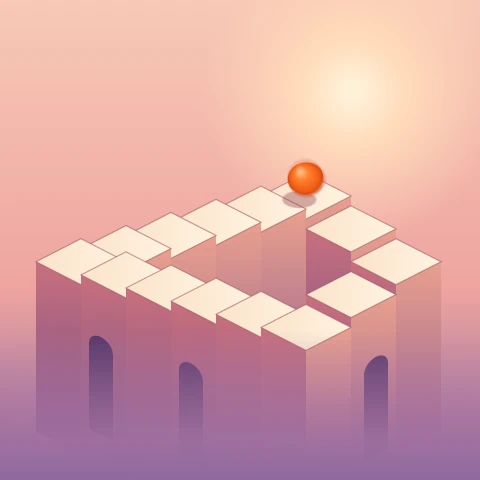</a><br><b>Perfect loop</b><br><sub>You watch it again before you notice.</sub></td>
<td width="25%" valign="top"><a href="plugins/video/skills/video/styles/wait-for-it.md"></a><br><b>Wait for it</b><br><sub>A question you can only answer by staying.</sub></td>
<td width="25%" valign="top"><a href="plugins/video/skills/video/styles/chat-story.md"></a><br><b>Chat story</b><br><sub>A conversation with a turn.</sub></td>
</tr>
</table>

## Made to travel

Ask for views and it does the thinking before it draws anything: who sends this to whom, the message they type with it, the question that opens before second 2, the turn, ten hooks in five forms, and a score the plan must pass. After you post, it reads your numbers against your own normal and writes down one lesson.

It is built on [what platforms publish and what research found](plugins/video/skills/video/reference/viral.md), with sources. No skill can promise a viral video, and this one will not pretend to.

## Many styles in one film

A film can go through six worlds and still be one film. Each style gets a job, and [one thing never changes](plugins/video/skills/video/reference/mixing.md).

## Install

As a plain skill, called with `/video`:

```bash
git clone https://github.com/munvard/video-skill
mkdir -p ~/.claude/skills && cp -r video-skill/plugins/video/skills/video ~/.claude/skills/video
```

As a plugin, called with `/video:video`, inside Claude Code:

```text
/plugin marketplace add munvard/video-skill
/plugin install video@video-skill
```

It needs Claude Code, ffmpeg and Python 3. It uses Node and Chrome for motion design and Blender for 3D when you have them. A long film is a long, heavy run: it measures the render time and tells you first. It never publishes or spends without your yes.

## What is inside

| Part | What it does |
|---|---|
| [`SKILL.md`](plugins/video/skills/video/SKILL.md) | the director: understand, choose, plan, build, check, deliver, learn |
| [`styles/`](plugins/video/skills/video/styles/index.md) | 46 cards: look, motion, type, sound, tools, hook, and how each one fails |
| [`viral.md`](plugins/video/skills/video/reference/viral.md) | hooks, reasons to send, a score, reading results |
| [`mixing.md`](plugins/video/skills/video/reference/mixing.md) | many styles, one film |
| [`new-style.md`](plugins/video/skills/video/reference/new-style.md) | learn a style from a film without copying it, or invent one |
| [`craft.md`](plugins/video/skills/video/reference/craft.md), [`checklist.md`](plugins/video/skills/video/reference/checklist.md), [`engines.md`](plugins/video/skills/video/reference/engines.md) | story, motion, type, sound, tools, and 13 checks |
| [`check.py`](plugins/video/skills/video/scripts/check.py) | frame sheets, dark stretches, loop seam and loudness of any film |

## Honest status

2 styles are **proven**: a finished film that its owner or a few test viewers clearly liked, with no view numbers yet. 3 are **studied**: measured frame by frame from real work. 41 are **drafts**: designed from craft knowledge, with the preview above and no full film yet. Each card says which. The previews are short style sketches made in code for this page, and the source that renders them is in [`gallery/src`](gallery/src).

## Add a style

Read [`new-style.md`](plugins/video/skills/video/reference/new-style.md), add a card and a row in the index, then run `python tests/build_readme.py` and `python tests/check_repo.py`. New cards start as drafts. A card needs its own preview, and a person who knows your reference must not call it a copy.

MIT licence. Third-party material is listed in [`gallery/LICENSES.md`](gallery/LICENSES.md).
