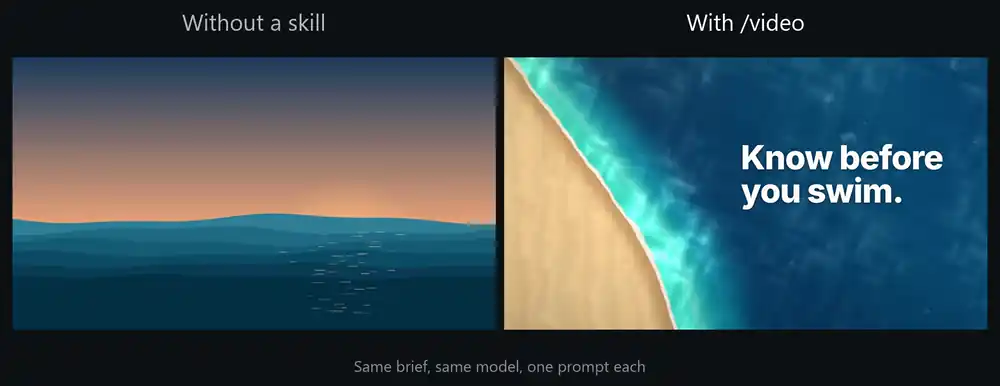

<div align="center">

<a href="https://munvard.github.io/video-skill"></a>

# /video

## Type /video. Get your launch film.

A Claude Code skill that makes launch and product videos (motion design, 3D, music) and checks every frame.<br>
Open source, MIT.

<a href="LICENSE"></a> <a href="#install"></a>

</div>

## Install

Inside Claude Code:

```text
/plugin marketplace add munvard/video-skill
/plugin install video@video-skill
```

Then open your project and type `/video`. With no other words, it reads your README, site and screenshots and makes
that product's launch film.

## Films it made

Each one came from a single prompt in a clean folder, with no editing by hand. Click a film to watch it with sound and
see its prompt, its plan and its numbers. More in the [gallery](https://munvard.github.io/video-skill).

<table>
<tr><td valign="top"><a href="https://munvard.github.io/video-skill/films/mossbook.html"></a><br><sub><b>Mossbook, an invented plant app</b>. One prompt, 31 min.</sub></td></tr>
</table>

## Same prompt, with and without

<a href="https://munvard.github.io/video-skill/films/tidepool.html"></a>

The same 15 second brief, the same model, one prompt each. Without a skill: 3.3 minutes and 4 of 8
checks failed. With `/video`: 6.4 minutes and 0 of 8 failed.

<details><summary>How this was tested</summary>

Claude Code got the brief twice in a clean folder: once with nothing installed, once with `/video`. The failed checks
without the skill were frame 0, dead, end hold, slab. This brief was also used while the skill was built (two of its
rules came from an earlier run), so it shows the result fairly but it is not a blind test. The
[film page](https://munvard.github.io/video-skill/films/tidepool.html) has both prompts, both films and every number.

</details>

Saw a reel that compares Claude Code's default video with `/video`? Each one is cut from two real runs of the same
prompt, and the run summaries (time, turns, cost, the session's own last message) are in [docs/unslop](docs/unslop):
[paper boat](docs/unslop/1), [tiny astronaut](docs/unslop/2), [whale](docs/unslop/3), [jellyfish](docs/unslop/7). One /video run failed: [fox](docs/unslop/8). Pairs where both runs were good are there too, with no
reel: [Orbel, a desk timer](docs/unslop/4), [rubber duck](docs/unslop/5), [keyboard](docs/unslop/6).

## What it does

- **Thinks like a director.** It pitches four very different ideas, shows you stills and a moving test before the
  full render, and redoes a look that is not clearly beautiful.
- **Motion design in code.** HTML and canvas pages with measured easing, rendered frame by frame in headless Chrome.
- **Real 3D.** Blender with free CC0 materials, models and light from Poly Haven and ambientCG.
- **Sound made in code.** Music on a beat grid, a sound for every event on screen, an optional local voice.
- **Checks every frame like a phone viewer.** Frame 0, reading time, text size, the 9:16 safe area, loudness, the
  first 3 seconds of a reel: PASS or FAIL with numbers, and it fixes every FAIL before it delivers.
- **Learns your taste.** Your reactions go to `.video/taste.md` in your project and win over its defaults.

```text
/video a 20 second launch post for our search, 9:16
/video a 16:9 hero film for the site, make it 3D
/video learn the style of reference.mp4
```

<details><summary><b>What you need</b></summary>

- Claude Code, with a Claude plan (Pro, Max, Team or Enterprise) or an API account
- ffmpeg and Python 3 with numpy
- Optional: Node 22 and Chrome for motion design, Blender for 3D

The first run checks your tools and tells you what is missing. Everything else is free and runs on your computer: no
API keys, no paid services.

</details>

<details><summary><b>What is inside</b></summary>

| Part | What it does |
|---|---|
| [`SKILL.md`](plugins/video/skills/video/SKILL.md) | the director: understand, choose, plan, look gate, build, check, deliver, learn |
| [`kit/`](plugins/video/skills/video/kit/README.md) | the render engine: a parallel headless Chrome renderer, a 2D canvas kit, a ray tracer |
| [`scripts/`](plugins/video/skills/video/scripts) | `check.py` gates, `sound.py`, `voice.py`, `finish.py`, `assets.py`, `doctor.py`, `study.py`, the Blender kit |
| [`styles/`](gallery/README.md) | 46 style cards, 12 at full depth, with a preview each |
| [`reference/`](plugins/video/skills/video/reference) | craft rules, sound, Blender, engines, the checklist |

</details>

<details><summary><b>Questions and limits</b></summary>

- **How long does a film take?** In the tests above, a motion design film took 6 to 32 minutes. A Blender 3D film
  takes one to two hours on a laptop GPU. QUICK mode is one idea and a render in minutes.
- **Does it use a lot of my plan?** A STUDIO film is a long run and uses a fair part of a Claude plan's limits.
  QUICK is the cheap path.
- **Which computers?** Tested on Windows 11 and macOS on Apple silicon. Linux paths are written but less tested.
- **Styles:** 0 proven by a film, 0 measured from real work, 46 drafts.
  See the [style library](gallery/README.md).
- Live-action styles need your own footage. No skill can promise views.

</details>

MIT licence. Borrowed code and its licences: [`NOTICE.md`](plugins/video/skills/video/NOTICE.md). Fonts and gallery
files: [`gallery/LICENSES.md`](gallery/LICENSES.md). Release notes: [`RELEASE_NOTES.md`](RELEASE_NOTES.md).
