# The style library

46 style cards, 12 of them at full depth (marked ★). `/video` loads only the one or two cards it picks, so the
library costs your chat almost nothing. It can also mix styles, invent one, or work without one.

The previews are short style sketches made in code for this page; the source that renders them is in
[`src`](src). They are not films made by the skill: those are on the [main page](../README.md).

Status: **proven** means a film made by this skill in that style passed every gate and is shown with its prompt.
**studied** means measured from real work with `scripts/study.py`. **draft** means designed from craft knowledge and
not tested in a film yet. Today: 0 proven, 0 studied, 46 drafts.

### Cinematic 3D

<table>
<tr>
<td width="25%" valign="top"><a href="../plugins/video/skills/video/styles/one-take-thread.md">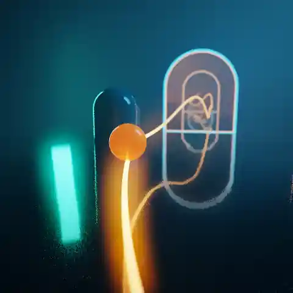</a> <b>One take with a thread</b> ★ A single camera move through several worlds, led by one glowing object.</td>
<td width="25%" valign="top"><a href="../plugins/video/skills/video/styles/toy-diorama.md">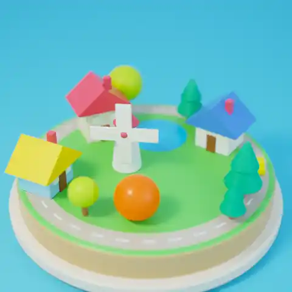</a> <b>Miniature world</b> A tiny, detailed, bright world you want to touch.</td>
<td width="25%" valign="top"><a href="../plugins/video/skills/video/styles/clay-stop-motion.md">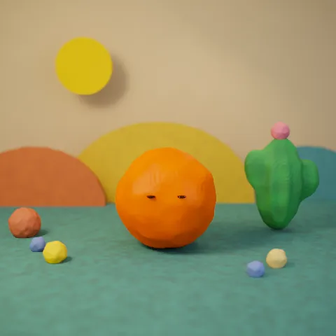</a> <b>Clay stop motion</b> Warm, handmade and a bit imperfect.</td>
<td width="25%" valign="top"><a href="../plugins/video/skills/video/styles/macro-material.md">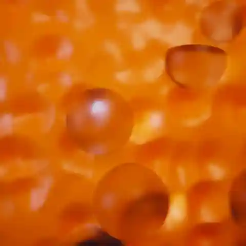</a> <b>Macro material</b> ★ So close you can almost feel it.</td>
</tr>
<tr>
<td width="25%" valign="top"><a href="../plugins/video/skills/video/styles/isometric-city.md">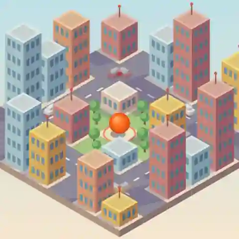</a> <b>Isometric city</b> A living map from above.</td>
<td width="25%" valign="top"><a href="../plugins/video/skills/video/styles/glass-light.md">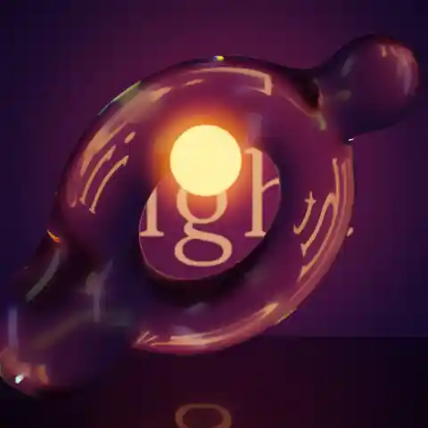</a> <b>Glass and light</b> ★ Calm, expensive and abstract.</td>
<td width="25%" valign="top"><a href="../plugins/video/skills/video/styles/infinite-zoom.md">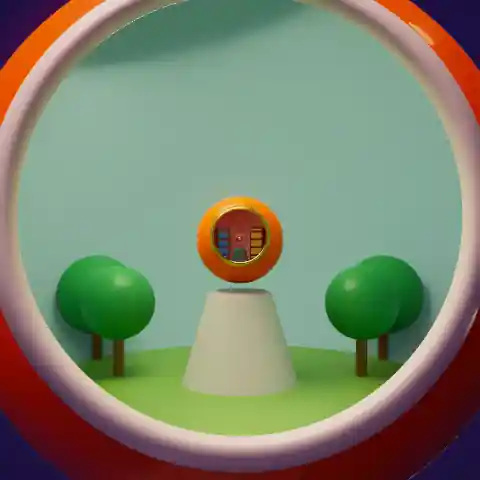</a> <b>Infinite zoom</b> You keep falling into the next picture.</td>
<td width="25%" valign="top"><a href="../plugins/video/skills/video/styles/exploded-view.md">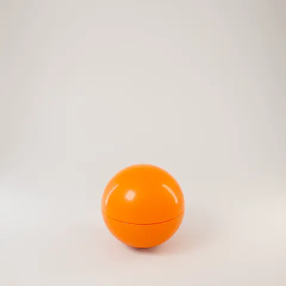</a> <b>Exploded view</b> ★ The object opens and explains itself.</td>
</tr>
</table>

### Minimal motion

<table>
<tr>
<td width="25%" valign="top"><a href="../plugins/video/skills/video/styles/shape-morph.md">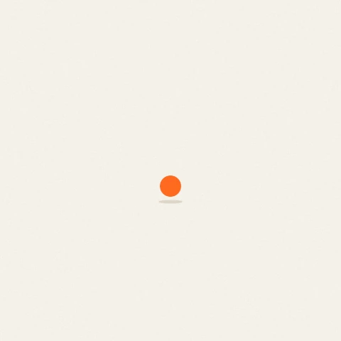</a> <b>Shape morph</b> ★ Quiet, exact, and every object turns into the next.</td>
<td width="25%" valign="top"><a href="../plugins/video/skills/video/styles/kinetic-type.md">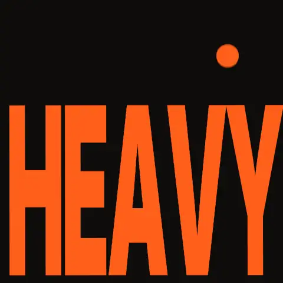</a> <b>Kinetic type</b> ★ Only words, and they act.</td>
<td width="25%" valign="top"><a href="../plugins/video/skills/video/styles/swiss-grid.md">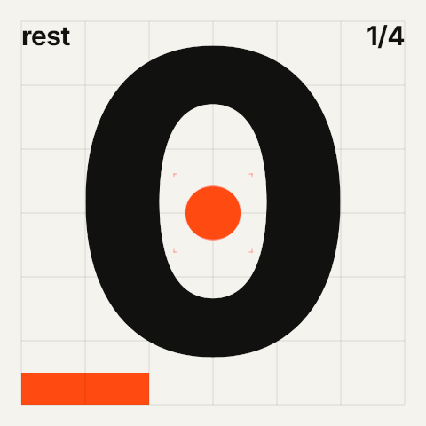</a> <b>Swiss grid</b> ★ A poster that moves.</td>
<td width="25%" valign="top"><a href="../plugins/video/skills/video/styles/one-line.md">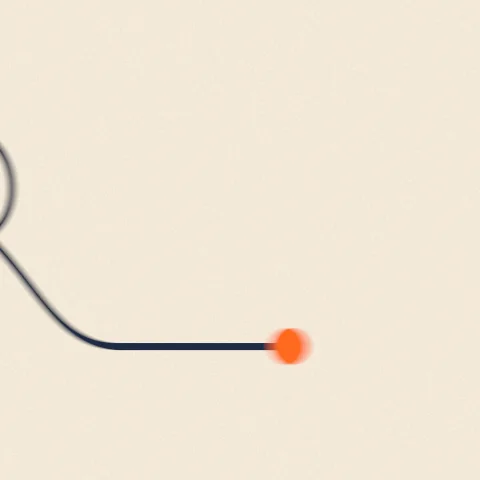</a> <b>One continuous line</b> A single pen never leaves the page.</td>
</tr>
<tr>
<td width="25%" valign="top"><a href="../plugins/video/skills/video/styles/soft-gradient.md">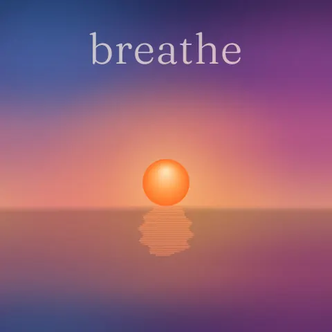</a> <b>Soft gradient</b> Breathing color and one sentence.</td>
<td width="25%" valign="top"><a href="../plugins/video/skills/video/styles/blueprint.md">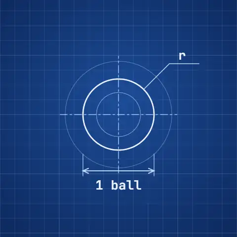</a> <b>Blueprint</b> The drawing becomes the real thing.</td>
</tr>
</table>

### Screen and UI

<table>
<tr>
<td width="25%" valign="top"><a href="../plugins/video/skills/video/styles/screen-cinema.md">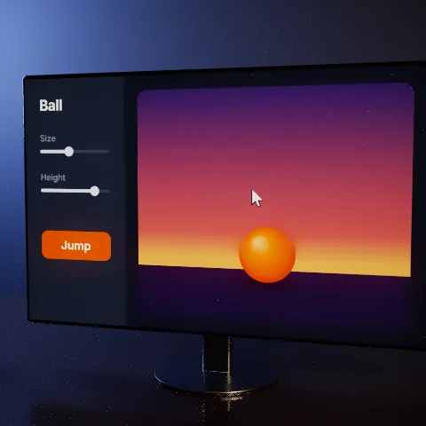</a> <b>Screen cinema</b> ★ A real take filmed like a movie.</td>
<td width="25%" valign="top"> <b>The cursor is the hero</b> ★ A tiny character with a job.</td>
<td width="25%" valign="top"><a href="../plugins/video/skills/video/styles/floating-layers.md">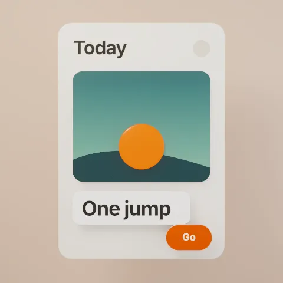</a> <b>Floating layers</b> ★ The interface opens in space.</td>
<td width="25%" valign="top"><a href="../plugins/video/skills/video/styles/before-after.md">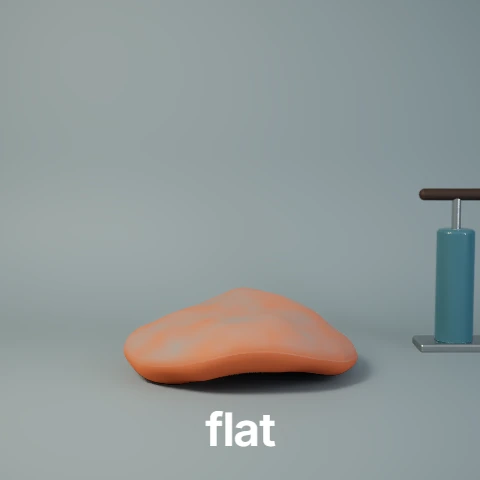</a> <b>Before and after</b> One problem, two worlds.</td>
</tr>
<tr>
<td width="25%" valign="top"><a href="../plugins/video/skills/video/styles/terminal-poem.md">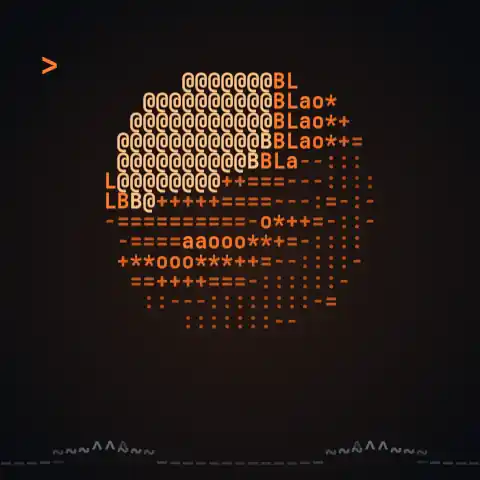</a> <b>Terminal poem</b> Only text, and something huge happens.</td>
<td width="25%" valign="top"><a href="../plugins/video/skills/video/styles/honest-race.md">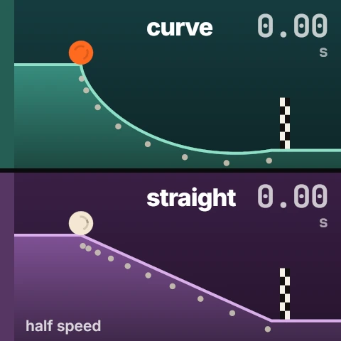</a> <b>Honest race</b> Two ways, one clock.</td>
</tr>
</table>

### Handmade and graphic

<table>
<tr>
<td width="25%" valign="top"><a href="../plugins/video/skills/video/styles/paper-collage.md">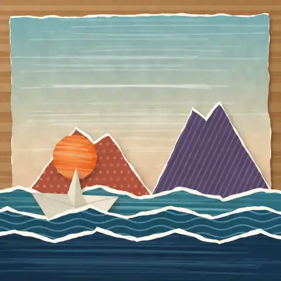</a> <b>Paper collage</b> Cut paper and photos on a table.</td>
<td width="25%" valign="top"><a href="../plugins/video/skills/video/styles/scrapbook.md">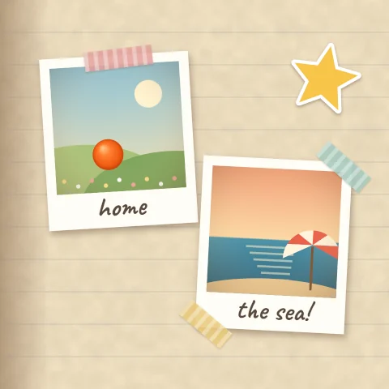</a> <b>Scrapbook</b> A private book being filled.</td>
<td width="25%" valign="top"><a href="../plugins/video/skills/video/styles/riso-print.md">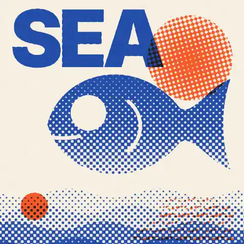</a> <b>Riso print</b> Two inks slightly out of line.</td>
<td width="25%" valign="top"><a href="../plugins/video/skills/video/styles/whiteboard-lesson.md">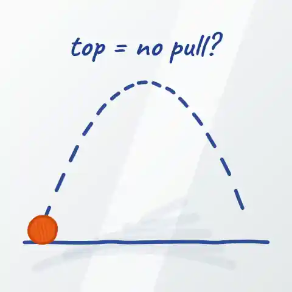</a> <b>Whiteboard lesson</b> A good teacher draws it for you.</td>
</tr>
<tr>
<td width="25%" valign="top"><a href="../plugins/video/skills/video/styles/pixel-art.md">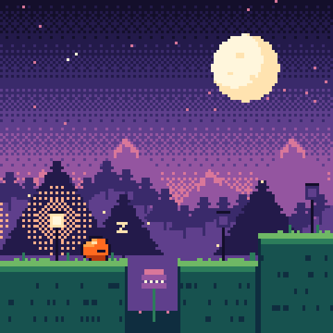</a> <b>Pixel art</b> A small original world in pixels.</td>
<td width="25%" valign="top"><a href="../plugins/video/skills/video/styles/comic-panels.md">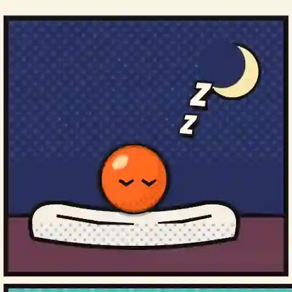</a> <b>Comic panels</b> A page that comes alive.</td>
<td width="25%" valign="top"><a href="../plugins/video/skills/video/styles/retro-computer.md">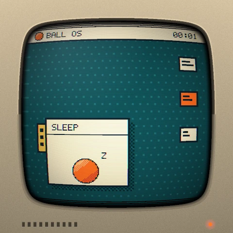</a> <b>Retro computer</b> An invented old computer runs your idea.</td>
<td width="25%" valign="top"><a href="../plugins/video/skills/video/styles/analog-tape.md">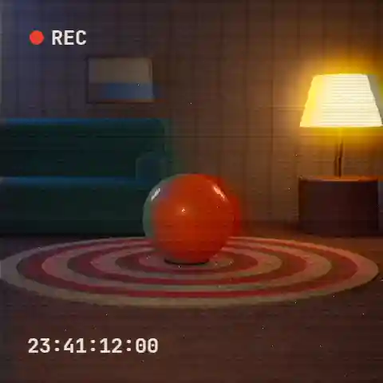</a> <b>Analog tape</b> A found recording.</td>
</tr>
</table>

### Live footage

<table>
<tr>
<td width="25%" valign="top"><a href="../plugins/video/skills/video/styles/pov-moment.md">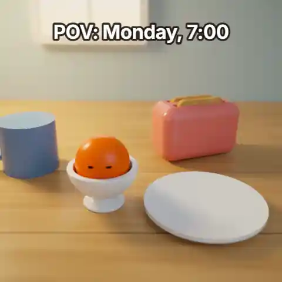</a> <b>POV moment</b> You are the person it happens to.</td>
<td width="25%" valign="top"> <b>Face to camera</b> One person says one true thing.</td>
<td width="25%" valign="top"><a href="../plugins/video/skills/video/styles/desk-hands.md">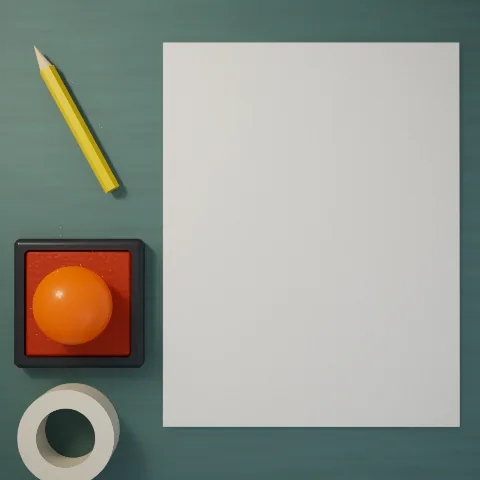</a> <b>Hands on a desk</b> A quiet making process from above.</td>
<td width="25%" valign="top"> <b>Sound first</b> You hear it before you understand it.</td>
</tr>
<tr>
<td width="25%" valign="top"><a href="../plugins/video/skills/video/styles/mini-documentary.md">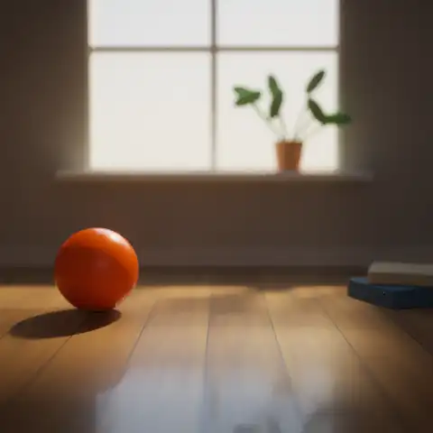</a> <b>Mini documentary</b> A real person and what changed.</td>
</tr>
</table>

### Story and comedy

<table>
<tr>
<td width="25%" valign="top"><a href="../plugins/video/skills/video/styles/mascot-short.md">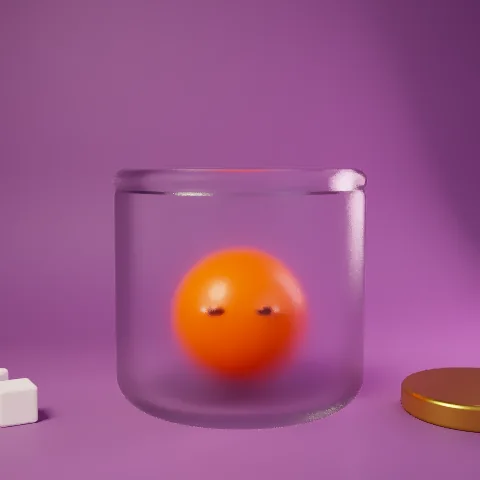</a> <b>Mascot short</b> A character wants something.</td>
<td width="25%" valign="top"><a href="../plugins/video/skills/video/styles/one-joke.md">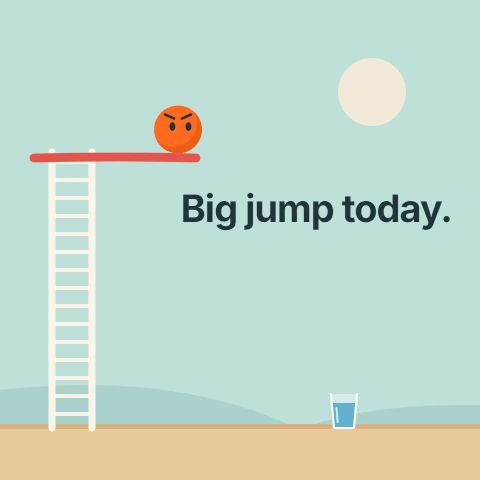</a> <b>One joke</b> A setup, a turn, and it ends.</td>
<td width="25%" valign="top"><a href="../plugins/video/skills/video/styles/movie-trailer.md">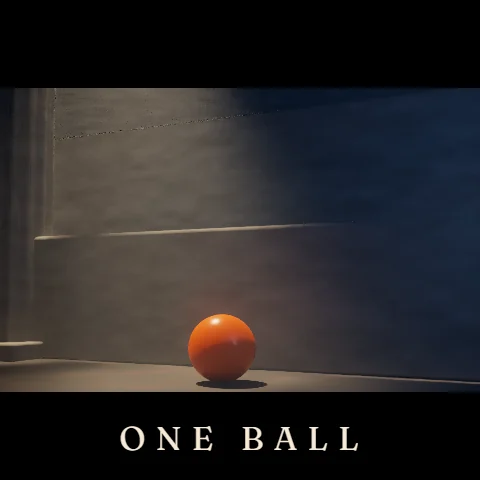</a> <b>Movie trailer</b> A tiny problem treated as an epic.</td>
<td width="25%" valign="top"><a href="../plugins/video/skills/video/styles/myth-turn.md">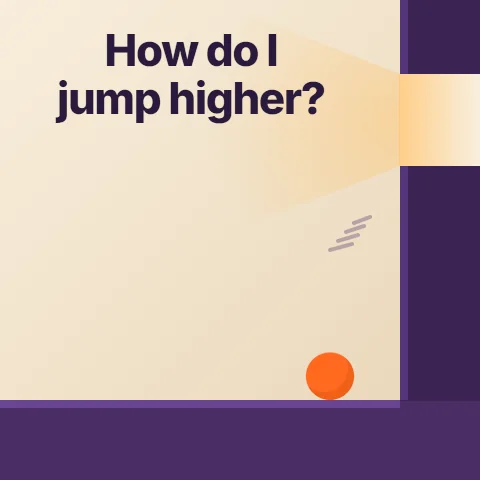</a> <b>Myth and turn</b> An argument with a turn in the middle.</td>
</tr>
<tr>
<td width="25%" valign="top"><a href="../plugins/video/skills/video/styles/native-lofi.md">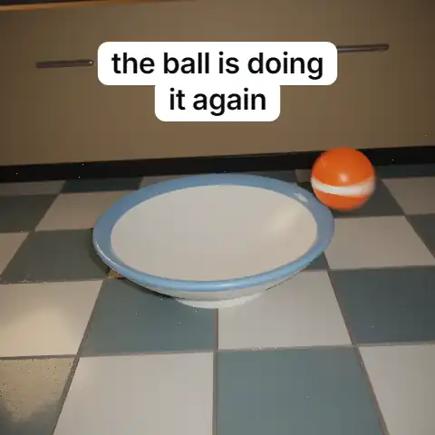</a> <b>Native low-fi</b> A friend made it on a phone.</td>
</tr>
</table>

### Data and explanation

<table>
<tr>
<td width="25%" valign="top"><a href="../plugins/video/skills/video/styles/data-motion.md">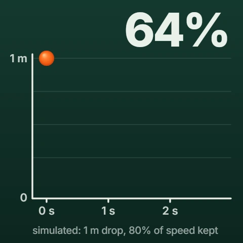</a> <b>Data in motion</b> ★ One number becomes something you can see.</td>
<td width="25%" valign="top"><a href="../plugins/video/skills/video/styles/cutaway.md">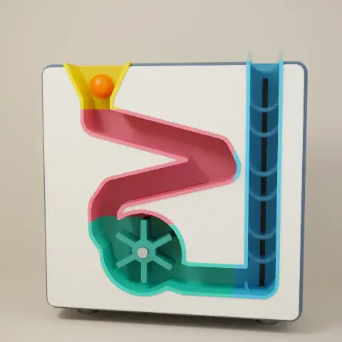</a> <b>Cutaway</b> The wall opens and you see how it works.</td>
<td width="25%" valign="top"><a href="../plugins/video/skills/video/styles/map-journey.md">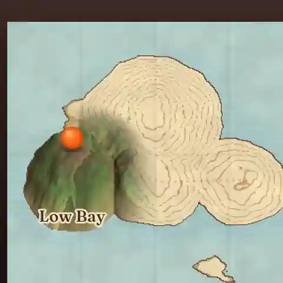</a> <b>Map journey</b> One dot crosses the world.</td>
<td width="25%" valign="top"><a href="../plugins/video/skills/video/styles/time-machine.md">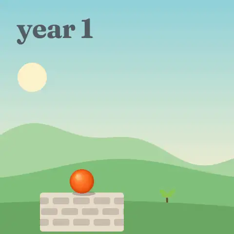</a> <b>Time machine</b> One object through many years.</td>
</tr>
</table>

### Social speed

<table>
<tr>
<td width="25%" valign="top"><a href="../plugins/video/skills/video/styles/beat-cut.md">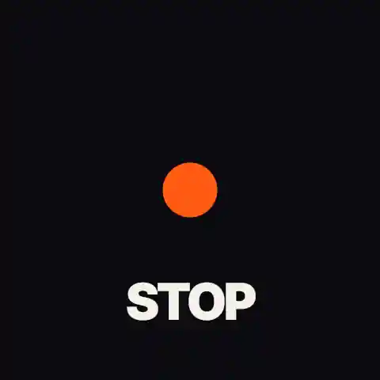</a> <b>Beat cut</b> ★ Loud, fast, in rhythm.</td>
<td width="25%" valign="top"><a href="../plugins/video/skills/video/styles/perfect-loop.md">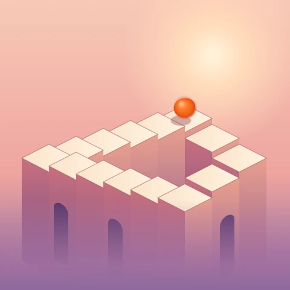</a> <b>Perfect loop</b> You watch it again before you notice.</td>
<td width="25%" valign="top"><a href="../plugins/video/skills/video/styles/wait-for-it.md">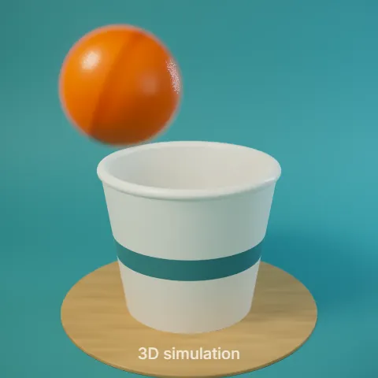</a> <b>Wait for it</b> A question you can only answer by staying.</td>
<td width="25%" valign="top"><a href="../plugins/video/skills/video/styles/chat-story.md">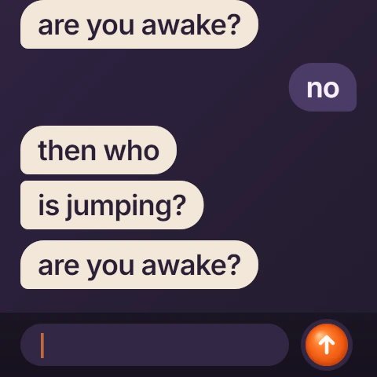</a> <b>Chat story</b> A conversation with a turn.</td>
</tr>
</table>

Add a style: read [`new-style.md`](../plugins/video/skills/video/reference/new-style.md), add a card and a row in the
index, then run `python tests/build_readme.py` and `python tests/check_repo.py`. New cards start as drafts.

Licences of the fonts and other third-party files used here: [`LICENSES.md`](LICENSES.md).
